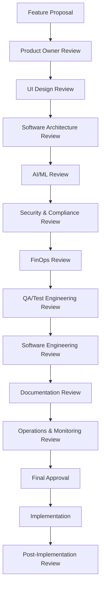

# Chain of Reasoning Process

## Overview

This document defines our standardized decision-making process for all feature development. Each feature must progress through review and approval from all defined roles to ensure comprehensive consideration of business, design, technical, security, and implementation aspects.

## Process Flow



## Role Responsibilities

### 1. Product Owner

- **Primary Responsibilities:**
  - Define business requirements and user needs
  - Validate feature alignment with product strategy
  - Prioritize features based on business value
  - Define success metrics
  - Specify compliance requirements for different regions
  - Document user training and onboarding needs
  - Define KPIs for AI model effectiveness
- **Deliverables:**
  - Feature definition in PRD
  - User stories
  - Acceptance criteria
  - Business justification
  - Regional compliance matrix
  - User training requirements
  - Success metrics for AI components

### 2. UI Designer

- **Primary Responsibilities:**
  - Create user-friendly interfaces with ease of use as primary focus
  - Ensure design consistency across products
  - Validate accessibility compliance
  - Optimize user workflows for high adoption
  - Design analytics capabilities to track user behavior
- **Deliverables:**
  - Wireframes/mockups
  - Design specifications
  - Interaction patterns
  - UI component recommendations
  - User behavior tracking requirements
  - Utilization measurement plan
  - Adoption metrics definition

### 3. Software Architect

- **Primary Responsibilities:**
  - Validate technical feasibility
  - Define technical approach and system design
  - Ensure alignment with existing architecture
  - Identify technical dependencies
  - Design for reliability and cost efficiency
  - Implement security by design principles
  - Plan for scalability and easier maintenance
  - Optimize to reduce KTLO (Keep The Lights On) spend
  - Design for observability and monitoring
  - Define API versioning strategy
  - Plan for disaster recovery
  - Design for multi-region deployment
- **Deliverables:**
  - Technical design document
  - Architecture diagrams
  - API specifications
  - Technology recommendations
  - Reliability and scalability assessment
  - Maintenance cost projection
  - Technical debt evaluation
  - Monitoring architecture
  - API versioning policy
  - Disaster recovery runbooks
  - Multi-region deployment plan

### 4. AI/ML Engineer

- **Primary Responsibilities:**
  - Design and validate AI/ML models for vulnerability detection
  - Ensure quality and representativeness of training data
  - Monitor model performance and drift
  - Implement ethical AI practices
  - Optimize model performance and cost
  - Document model behavior and limitations
- **Deliverables:**
  - Model architecture documentation
  - Training data requirements and validation
  - Performance metrics and monitoring plan
  - Bias and fairness assessment
  - Model explainability documentation
  - Retraining strategy

### 5. Security & Compliance

- **Primary Responsibilities:**
  - Identify security requirements
  - Validate compliance with regulations
  - Review authentication/authorization aspects
  - Assess data privacy implications
  - Ensure SOC2 security standards compliance
  - Verify GDPR compliance requirements
  - Apply AWS Security best practices
  - Regular security posture assessment
  - Define incident response procedures
  - Specify audit logging requirements
  - Review data retention policies
  - Validate RBAC implementation
- **Deliverables:**
  - Security review documentation
  - Compliance checklist (SOC2, GDPR, AWS)
  - Risk assessment and mitigation plan
  - Security testing requirements
  - Data protection impact assessment
  - Security monitoring requirements
  - AWS security configuration validation
  - Incident response plan
  - Audit logging requirements
  - Data retention policy
  - Access control matrix

### 6. FinOps Review

- **Primary Responsibilities:**
  - Assess cost implications of the feature
  - Evaluate ROI and business value
  - Define cost tracking mechanisms
  - Ensure each product/feature is independently trackable
  - Analyze usage-based costs
  - Identify cost optimization opportunities
  - Project long-term financial impact
  - Analyze cost of AI/ML components
  - Calculate ROI for automation
  - Evaluate cost of data storage and processing
- **Deliverables:**
  - Cost projection analysis
  - Resource utilization estimate
  - Cost tracking implementation plan
  - Usage metrics definition
  - Cost attribution model
  - Cloud resource optimization recommendations
  - Financial sustainability assessment
  - AI/ML cost projection
  - Automation ROI analysis
  - Data storage cost optimization

### 7. QA/Test Engineer

- **Primary Responsibilities:**
  - Define test strategy and test cases
  - Ensure test coverage for all requirements
  - Implement automated testing frameworks
  - Validate security test scenarios
  - Performance and load testing
  - User acceptance testing coordination
- **Deliverables:**
  - Test plan and test cases
  - Test automation framework
  - Test coverage report
  - Performance test results
  - Security test results
  - UAT sign-off

### 8. Software Engineer

- **Primary Responsibilities:**
  - Assess implementation complexity
  - Identify technical limitations
  - Define testing approach
  - Estimate development effort
  - Ensure performance efficiency
  - Implement features with maintainability in mind
  - Follow coding standards and best practices
  - Implement monitoring and observability
  - Ensure documentation completeness
- **Deliverables:**
  - Implementation plan
  - Testing strategy
  - Effort estimation
  - Code review criteria
  - Performance benchmarks
  - Maintenance guidelines
  - Code documentation
  - Monitoring implementation

### 9. Documentation Specialist

- **Primary Responsibilities:**
  - Define documentation requirements
  - Ensure consistency across documentation
  - Validate technical accuracy
  - Organize documentation structure
  - Maintain version control
  - Ensure accessibility compliance
- **Deliverables:**
  - Documentation plan
  - API documentation
  - User guides
  - Release notes
  - Training materials
  - Documentation review checklist

### 10. Operations Engineer

- **Primary Responsibilities:**
  - Define deployment procedures
  - Implement monitoring and alerting
  - Ensure system reliability
  - Plan for capacity scaling
  - Document operational procedures
  - Implement disaster recovery
- **Deliverables:**
  - Deployment runbooks
  - Monitoring configuration
  - Alerting rules
  - Capacity planning
  - Incident response procedures
  - Disaster recovery plan

## Decision Documentation Template

For each feature, a decision document should be created with the following structure:

```markdown
# Feature: [Feature Name]

## Product Owner Review

- Business Requirements: [Description]
- User Need: [Description]
- Success Metrics: [Metrics]
- Priority: [High/Medium/Low]
- Regional Compliance: [Description]
- Training Requirements: [Description]
- Approved: [Yes/No] by [Name] on [Date]

## UI Design Review

- Design Approach: [Description]
- Accessibility Considerations: [Description]
- User Flow: [Description]
- User Behavior Tracking: [Description]
- Adoption Metrics: [Description]
- Approved: [Yes/No] by [Name] on [Date]

## Software Architecture Review

- Technical Approach: [Description]
- Architecture Impact: [Description]
- Dependencies: [List]
- Reliability Considerations: [Description]
- Scalability Plan: [Description]
- Maintenance Strategy: [Description]
- Security by Design Elements: [Description]
- Monitoring Architecture: [Description]
- API Versioning: [Description]
- Disaster Recovery: [Description]
- Approved: [Yes/No] by [Name] on [Date]

## AI/ML Review

- Model Architecture: [Description]
- Training Data Requirements: [Description]
- Performance Metrics: [Description]
- Bias and Fairness: [Description]
- Explainability: [Description]
- Monitoring Plan: [Description]
- Approved: [Yes/No] by [Name] on [Date]

## Security & Compliance Review

- Security Considerations: [Description]
- SOC2 Compliance Impact: [Description]
- GDPR Compliance Impact: [Description]
- AWS Security Best Practices: [Description]
- Data Protection Strategy: [Description]
- Risk Assessment: [Description]
- Incident Response: [Description]
- Audit Logging: [Description]
- Data Retention: [Description]
- Access Control: [Description]
- Approved: [Yes/No] by [Name] on [Date]

## FinOps Review

- Cost Projection: [Description]
- Usage-based Cost Analysis: [Description]
- Cost Tracking Implementation: [Description]
- Resource Utilization Estimate: [Description]
- ROI Assessment: [Description]
- Cost Optimization Recommendations: [Description]
- AI/ML Cost Analysis: [Description]
- Storage Cost Analysis: [Description]
- Approved: [Yes/No] by [Name] on [Date]

## QA/Test Engineering Review

- Test Strategy: [Description]
- Test Coverage: [Description]
- Automation Approach: [Description]
- Performance Testing: [Description]
- Security Testing: [Description]
- UAT Plan: [Description]
- Approved: [Yes/No] by [Name] on [Date]

## Software Engineering Review

- Implementation Complexity: [High/Medium/Low]
- Testing Strategy: [Description]
- Effort Estimate: [Description]
- Performance Considerations: [Description]
- Maintenance Impact: [Description]
- Code Quality: [Description]
- Monitoring Implementation: [Description]
- Approved: [Yes/No] by [Name] on [Date]

## Documentation Review

- Technical Documentation: [Description]
- API Documentation: [Description]
- User Guides: [Description]
- Training Materials: [Description]
- Release Notes: [Description]
- Approved: [Yes/No] by [Name] on [Date]

## Operations & Monitoring Review

- Monitoring Strategy: [Description]
- Alerting Requirements: [Description]
- Logging Requirements: [Description]
- Incident Response: [Description]
- Disaster Recovery: [Description]
- Approved: [Yes/No] by [Name] on [Date]

## Final Decision

- Approved for Implementation: [Yes/No]
- Target Release: [Version]
- Implementation Owner: [Name/Role]
- Implementation Timeline: [Start Date] - [End Date]
- Notes: [Description]
```

## Implementation

## Post-Implementation Review

### Metrics Collection
- Performance Metrics: [Description]
- Usage Metrics: [Description]
- Error Rates: [Description]
- User Feedback: [Description]

### Review Process
- Review Period: [Timeframe]
- Review Team: [List of roles]
- Success Criteria: [Description]

### Outcomes
- Successes: [Description]
- Challenges: [Description]
- Lessons Learned: [Description]
- Improvement Actions: [Description]

### Final Sign-off
- Reviewed by: [Name/Role]
- Date: [Date]
- Next Steps: [Description]

This chain of reasoning process should be applied to all features listed in our roadmap. Each feature should have its own decision document stored in `/docs/decisions/` with the naming convention `YYYY-MM-DD-feature-name.md`.
